# ข้อเสนอโครงการ: ระบบตรวจกระดาษคำตอบฝนดินสอ (OMR) ที่ทนต่อภาพจริงและบอกข้อที่ไม่แน่ใจ
*(Robust Pencil Optical Mark Recognition System for Mobile-Captured Answer Sheets with Rejection/Tri-State Confidence Flagging)*

---

## ข้อมูลโครงงาน (Project Metadata)
* **รหัสวิชา:** ICE415 Digital Image Processing (ภาคการศึกษา 1/2567 หรือ 2/2567)
* **ประเภทโครงงาน:** หัวข้อที่ 6 จาก Problem Bank (*ตรวจกระดาษคำตอบ OMR — อ่านคำตอบจากกระดาษฝนดินสอ*)
* **การเพิ่มมุมมองเฉพาะตัว (Own Twist):**
  * **แบบ A (ขยายขอบเขต):** พัฒนากลไกการตัดสินใจแบบสามสถานะ (*Tri-State Decision Logic*) พร้อมขอบเขตการปฏิเสธ (*Rejection Threshold*) เพื่อคัดแยกข้อที่กำกวมส่งให้มนุษย์ตรวจทาน (*Human-in-the-Loop*)
  * **แบบ B (เพิ่มเงื่อนไขยาก):** รองรับภาพถ่ายจริงจากกล้องสมาร์ตโฟนที่มีเงาตกกระทบ (*Shadows*), มุมมองเอียงบิดเบี้ยว (*Perspective Skew*), รอยลบไม่สะอาด (*Ghost Marks*), ดินสอฝนจาง (HB/2B), และแสงสะท้อนผงแกรไฟต์ (*Graphite Glare*)
  * **แบบ C (เปรียบเทียบวิธี):** ทำการทดลองเปรียบเทียบ (*Ablation Study*) ระหว่าง Global Otsu vs. Local Adaptive Gaussian Thresholding, การใช้ vs. ไม่ใช้ Mathematical Morphology (Closing/Opening), และ Contour Approximation vs. Hough Transform Deskewing

---

## บทสรุปโครงการ (Executive Summary)

โครงการนี้เสนอการศึกษา ออกแบบ และพัฒนาต้นแบบระบบอ่านคำตอบจากภาพถ่ายกระดาษคำตอบที่ฝนด้วยดินสอ (Optical Mark Recognition: OMR) บนโจทย์ภาพถ่ายจากกล้องโทรศัพท์มือถือในสภาพแวดล้อมจริง (Unconstrained Real-World Mobile Camera Captures) ซึ่งมีความท้าทายสูงกว่าเครื่องสแกนตั้งโต๊ะ (Flatbed Scanner) หรือเครื่องตรวจ OMR เฉพาะทาง เนื่องจากภาพถ่ายจริงมักประสบปัญหามุมมองเอียงบิดเบี้ยว (Perspective Skew), การกระจายแสงไม่สม่ำเสมอ เกิดเงาตกกระทบ (Non-uniform Illumination / Shadows), แสงสะท้อนจากผงกราไฟต์ดินสอ (Graphite Glare), กระดาษยับหรือมีรอยพับ, รวมถึงรอยเปื้อนจากการลบคำตอบไม่สะอาด (Imperfect Erasures)

ระบบที่นำเสนอจะประยุกต์ใช้ทฤษฎีและเทคนิคการประมวลผลภาพดิจิทัล (Digital Image Processing) ตามหลักสูตรวิชา **ICE415** โดยไม่ใช้โมเดล Deep Learning สำเร็จรูปเป็นแกนหลัก เพื่อให้สามารถเข้าใจและควบคุมกลไกเชิงคณิตศาสตร์ได้อย่างแท้จริง เทคนิคหลักประกอบด้วย:
1. การประเมินคุณภาพภาพถ่ายเบื้องต้นด้วย Laplacian Variance เพื่อตรวจจับภาพเบลอ (Motion/Defocus Blur)
2. การปรับปรุงคุณภาพและการตรวจจับขอบเขตเอกสาร (Document Boundary Detection) ด้วย Gaussian Filter, Canny Edge Detector และ Convex Hull / Polygonal Approximation (Douglas-Peucker) ร่วมกับเทคนิคเปรียบเทียบ Hough Line Transform
3. การดัดแก้ความบิดเบี้ยวเชิงเรขาคณิตด้วยการแปลงพิกัดเพอร์สเปกทีฟ (Perspective Transformation / Homography Mapping) สู่แคนวาสมาตรฐาน
4. การแบ่งส่วนภาพแบบปรับตัวตามบริเวณ (Adaptive Gaussian Thresholding) ที่ทนทานต่อการเปลี่ยนแปลงของแสงเงาเฉพาะที่
5. การดำเนินการทางมอร์โฟวิทยาทางคณิตศาสตร์ (Mathematical Morphology: Structuring Elements, Closing & Opening) เพื่อเชื่อมประสานเกล็ดผงดินสอและกำจัดสัญญาณรบกวนละอองยางลบ
6. การสกัดกรอบคำตอบด้วยการตัดพื้นที่สัมพัทธ์ (Relative Grid Mapping) และการใช้หน้ากากวงกลมศูนย์กลางร่วม (Concentric Inner Masking) เพื่อตัดเส้นขอบพิมพ์ของแบบฟอร์มทิ้ง
7. การวิเคราะห์คุณลักษณะรอยฝนด้วย Fill-Ratio Metric ร่วมกับค่าความแปรปรวนของเกล็ดดินสอเพื่อลดผลกระทบจากแสงสะท้อนผงแกรไฟต์

จุดเด่นสำคัญของโครงงานนี้คือ **"กลไกการตัดสินใจแบบสามสถานะ (Tri-State Decision Logic with Rejection Threshold)"** ซึ่งจำแนกผลการตรวจเป็น **"ฝน (Filled / Marked)"**, **"ไม่ฝน (Empty / Unmarked)"** และ **"กำกวม (Ambiguous / Uncertain)"** โดยส่งข้อที่หลักฐานไม่เพียงพอหรือคลุมเครือเข้าสู่คิวให้มนุษย์ตรวจทาน (Human-in-the-Loop Verification) แทนการบังคับเลือกคำตอบแบบ Binary ทั่วไป ช่วยลดอัตราการตัดสินคะแนนผิดพลาด (Grading Error) ในสถานการณ์ประเมินผลจริงได้อย่างมีนัยสำคัญ

---

## 1. ที่มาและความสำคัญของปัญหา (Background and Problem Statement)

การตรวจข้อสอบแบบเลือกตอบ (Multiple-Choice Questions: MCQ) ในสถาบันการศึกษายังคงเป็นภาระงานที่มีปริมาณมาก หากตรวจด้วยมือต้องใช้เวลาสูงและเสี่ยงต่อความผิดพลาดจากการล้าของสายตา ระบบตรวจกระดาษคำตอบอัตโนมัติ (OMR) ในอดีตจำเป็นต้องพึ่งพาเครื่องสแกนกระดาษเฉพาะทาง (Dedicated OMR Scanner) หรือ Flatbed Scanner ที่มีต้นทุนอุปกรณ์สูง จัดวางเอกสารได้ครั้งละจำกัด และต้องการการควบคุมแสงสว่างที่คงที่

การเปลี่ยนผ่านสู่การตรวจข้อสอบยุคใหม่ด้วย **"ภาพถ่ายจากสมาร์ตโฟน (Smartphone-based OMR)"** ช่วยเพิ่มความสะดวกและลดต้นทุนได้อย่างก้าวกระโดด ทว่ากลับสร้างความท้าทายเชิงวิศวกรรมการประมวลผลภาพอย่างมาก:
1. **ความบิดเบี้ยวทางเรขาคณิต (Geometric & Perspective Distortions):** มุมที่ผู้ใช้ถือกล้องถ่ายภาพมักไม่ได้ระนาบขนานกับกระดาษ (Non-parallel Camera Plane) ก่อให้เกิด Perspective Skew ทำให้ตำแหน่งพิกัดของช่องคำตอบบนภาพผิดเพี้ยนไปจากเทมเพลตมาตรฐาน
2. **การแปรผันของแสงสว่างและเงา (Illumination Gradient & Ambient Shadows):** แสงไฟในห้องเรียนหรือเงาจากตัวผู้ถือโทรศัพท์ทำให้กระดาษมีความสว่างไม่เท่ากัน การใช้เกณฑ์ความสว่างคงที่ค่าเดียวทั้งภาพ (Global Thresholding หรือ Otsu's Thresholding แบบมาตรฐาน) จะล้มเหลวทันที โดยพื้นที่ใต้เงาจะถูกมองเป็นรอยฝนดำทั้งหมด
3. **ธรรมชาติของรอยดินสอกราไฟต์ (Pencil Graphite Characteristics):**
   * นักเรียนใช้ดินสอที่มีความเข้มต่างกัน (เช่น HB, 2B จาง หรือ 2B แท้) หรือลงน้ำหนักมือไม่เท่ากัน
   * รอยฝนดินสอไม่ได้ทึบเรียบสนิท 100% แต่เป็นเกล็ดผงคาร์บอนที่มีพื้นผิวขรุขระ (Texture) และมีช่องว่างเนื้อกระดาษสีขาวแทรกอยู่ภายใน
   * แสงสะท้อนจากผงกราไฟต์ (Graphite Sheen/Glare) เมื่อตกกระทบกับแฟลชหรือหลอดไฟ อาจทำให้รอยฝนสีดำสะท้อนแสงกลายเป็นสีขาวสว่าง
   * คราบดินสอจากการลบไม่สะอาด (Smudges / Ghost Marks) มักมีความเข้มใกล้เคียงกับรอยฝนจริงที่จาง
4. **ความเสี่ยงของการตัดสินใจแบบ Binary (The Peril of Forced-Choice Binary OMR):** ระบบ OMR ทั่วไปบังคับให้วงกลมแต่ละวงเป็นได้เพียง 0 (ไม่ฝน) หรือ 1 (ฝน) เมื่อเจอกรณีรอยลบไม่สะอาดหรือฝนจาง ระบบจะสุ่มเสี่ยงเดาผิดพลาด ส่งผลต่อผลคะแนนของผู้สอบโดยตรง

ด้วยเหตุนี้ โครงการจึงมุ่งพัฒนาระบบ OMR ที่ทนทาน (Robust) มีกระบวนการประมวลผลภาพที่เป็นระบบ พร้อมทั้งมีระบบส่งสัญญาณเตือนกรณี "ไม่แน่ใจ (Ambiguous)" เพื่อสร้างความโปร่งใสและเที่ยงตรงตามหลักการวัดและประเมินผลทางการศึกษา

---

## 2. วัตถุประสงค์ (Objectives)

1. เพื่อศึกษา ออกแบบ และพัฒนาไปป์ไลน์การประมวลผลภาพดิจิทัล (Digital Image Processing Pipeline) สำหรับตรวจจับและดัดแก้ภาพถ่ายกระดาษคำตอบให้ตรงระนาบมาตรฐาน (Perspective Rectification) และระบุตำแหน่งช่องคำตอบได้อย่างแม่นยำ
2. เพื่อพัฒนาเทคนิคการแบ่งส่วนภาพแบบปรับตัว (Adaptive Segmentation) ร่วมกับการดำเนินการทางมอร์โฟวิทยา (Morphological Operations) ที่ทนทานต่อเงา แสงสะท้อน และรอยเกล็ดดินสอที่ไม่สม่ำเสมอ
3. เพื่อออกแบบและทดสอบ **"เกณฑ์การตัดสินใจแบบสามสถานะ (Tri-State Decision Logic: ฝน / ไม่ฝน / กำกวม)"** โดยกำหนดขอบเขตความเชื่อมั่น (Confidence Margin) และอัตราส่วนความหนาแน่นของพิกเซล (Fill-Ratio Metric)
4. เพื่อประเมินประสิทธิภาพของระบบเปรียบเทียบระหว่างชุดข้อมูลภาพถ่ายจำลองมาตรฐาน และชุดภาพถ่ายกระดาษคำตอบดินสอจริงที่มีความท้าทายหลากหลายสภาพแวดล้อมรวมมากกว่า 50 ภาพ (ตามเกณฑ์วิชา ICE415 ที่กำหนดไม่น้อยกว่า 40 ภาพ)
5. เพื่อทำการทดลองเปรียบเทียบเชิงวิชาการ (Ablation Study) ระหว่างวิธีการคลาสสิกต่างๆ ในเนื้อหาวิชา ICE415 เพื่อพิสูจน์ความจำเป็นและความเหมาะสมของแต่ละอัลกอริทึมที่เลือกใช้

---

## 3. ขอบเขตโครงการ (Project Scope)

| มิติการดำเนินงาน | ขอบเขตที่กำหนด |
| :--- | :--- |
| **รูปแบบกระดาษคำตอบ (Answer Sheet Form)** | กระดาษคำตอบแบบเลือกตอบ 4 หรือ 5 ตัวเลือก (A, B, C, D, E) ที่มีโครงสร้างเลย์เอาต์ (Layout Template) แน่นอน มีเส้นกรอบนอกหนา (Outer Bounding Frame) หรือจุดมาร์กเกอร์อ้างอิงตำแหน่ง 4 มุม (Fiducial Reference Markers) ขนาดมาตรฐานกระดาษ A4 |
| **สื่อที่ใช้บันทึกคำตอบ** | ดินสอดำสำหรับทำข้อสอบ (ดินสอ 2B หรือ HB) ทั้งกรณีฝนทึบสมบูรณ์, ฝนบางส่วน/ฝนจาง, กากบาท/ขีดทับ, และรอยลบแก้ไขที่มีคราบหลงเหลือ (Ghost Marks) |
| **อุปกรณ์นำเข้าภาพ (Input Source)** | ภาพถ่ายเดี่ยว (Single-shot Still Image) ความละเอียด Full HD (1080p) ขึ้นไป จากกล้องสมาร์ตโฟนทั่วไป หลากหลายสภาพแสงและมุมมอง |
| **ปริมาณข้อมูลทดสอบ** | รวมมากกว่า 50 ภาพจริงที่บันทึกเองในสภาพแวดล้อมหลากหลาย + ชุดข้อมูลมาตรฐานเปิด (Public Benchmark Dataset) จาก Kaggle เพื่อเป็นฐานเปรียบเทียบ (ผ่านเกณฑ์ขั้นต่ำ 40 ภาพของรายวิชา) |
| **ขั้นตอนการประมวลผลหลัก** | Quality Assessment &rarr; Grayscale & Filtering &rarr; Document Boundary & Perspective Warp &rarr; Adaptive Thresholding & Morphology &rarr; Grid Slicing & Inner Masking &rarr; Feature Extraction &rarr; Tri-State Decision Engine &rarr; Human-in-the-Loop Review UI |
| **ขอบเขตสิ่งที่ไม่ครอบคลุม (Out of Scope)** | • ไม่รองรับการตรวจลายมือเขียน (Handwriting Recognition / OCR สำหรับข้อสอบอัตนัย)<br>• ไม่ครอบคลุมการตรวจจับฟอร์มกระดาษที่ไม่เคยลงทะเบียนเทมเพลตล่วงหน้า (Arbitrary Layouts)<br>• ไม่ใช่ระบบตัดเกรดอัตโนมัติเต็มรูปแบบโดยปราศจากมนุษย์ควบคุม (ยังคงต้องมีขั้นตอน Human-in-the-Loop สำหรับข้อยกเว้น)<br>• ไม่ใช้โมเดล Deep Learning สำเร็จรูป (เช่น YOLO, Mask R-CNN) เป็นแกนหลักของการทำงาน เพื่อมุ่งเน้นองค์ความรู้ Digital Image Processing บริสุทธิ์ตามเกณฑ์รายวิชา |

---

## 4. วิธีการดำเนินงานและขั้นตอนทางเทคนิคเชิงลึก (Detailed Methodology & Technical Workflow)

กระบวนการทำงานของระบบถูกออกแบบเป็นไปป์ไลน์ต่อเนื่องที่มีขั้นตอนชัดเจน มีการตรวจสอบความผิดพลาดในแต่ละขั้น (Error Handling & Quality Gateways) และบูรณาการองค์ความรู้จากวิชา **ICE415 (Digital Image Processing)** สัปดาห์ที่ 1–10 ร่วมกับมาตรฐานคอมพิวเตอร์วิทัศน์สากล

### 4.1 แผนภาพสถาปัตยกรรมระบบและการไหลของข้อมูล (System Pipeline & Data Flow Architecture)

```mermaid
flowchart TD
    A["ภาพถ่ายจากสมาร์ตโฟน (Input RGB Image)"] --> B["[Step 1] การตรวจสอบคุณภาพภาพ (Quality Assessment)"]
    
    B --> B1{"คำนวณ Laplacian Variance<br>Var(∇²I) ≥ T_blur ?"}
    B1 -- "ไม่ผ่าน (Blurry)" --> B_ERR1["ปฏิเสธภาพ แจ้งเตือนถ่ายใหม่<br>(Motion / Defocus Blur)"]
    B1 -- "ผ่าน (Sharp)" --> B2{"ตรวจสอบ Histogram<br>Dynamic Range ปกติ ?"}
    B2 -- "ไม่ผ่าน (Over/Under)" --> B_ERR2["แจ้งเตือนปรับแสงสว่าง<br>(Exposure Clipping)"]
    B2 -- "ผ่าน (Valid)" --> C["[Step 2] แปลง Grayscale & ปรับปรุงขอบเขตเอกสาร"]

    C --> C1["แปลง Grayscale (Luminance Weighting)"]
    C1 --> C2["Gaussian Smoothing Blur (5x5, σ = 1.2)"]
    C2 --> C3["Canny Edge Detection (Sobel + NMS + Hysteresis)"]
    C3 --> C4["ค้นหา Contours & Douglas-Peucker (approxPolyDP)"]
    
    C4 --> D{"ตรวจพบคอนทัวร์ 4 จุดมุม<br>(Quadrilateral) ?"}
    D -- "พบชัดเจน" --> E["[Step 3] จัดเรียง 4 มุม & คำนวณ Homography Matrix"]
    D -- "ขอบกระดาษกลืนกับโต๊ะ" --> D_FALLBACK["สลับใช้ Corner Fiducial Markers<br>หรือ Hough Line Transform"]
    D_FALLBACK --> E

    E --> E1["cv2.warpPerspective สู่ Canonical Canvas (A4 Aspect Ratio)"]
    E1 --> F["[Step 4] การแบ่งส่วนภาพแบบปรับตัว & มอร์โฟวิทยา"]

    F --> F1["Local Adaptive Gaussian Thresholding (W=41x41, C=8)"]
    F1 --> F2["Morphological Closing (เชื่อมต่อเกล็ดผงดินสอแกรไฟต์)"]
    F2 --> F3["Morphological Opening (กำจัดละอองฝุ่นและผงยางลบ)"]
    
    F3 --> G["[Step 5] การจัดตำแหน่งกรอบคำตอบ & สกัดคุณลักษณะ"]
    G --> G1["Relative Coordinate Grid Slicing ตามแบบฟอร์ม"]
    G1 --> G2["Concentric Inner Circular Masking (ตัดเส้นขอบพิมพ์ทิ้ง)"]
    G2 --> G3["คำนวณ Fill-Ratio (F_i) & เกรเดียนต์ผิวสัมผัส (Texture Std)"]

    G3 --> H["[Step 6] กลไกการตัดสินใจสามสถานะ (Tri-State Decision Logic)"]
    H --> H1{"เปรียบเทียบ F_first, F_second<br>กับ T_low, T_high และ ΔF"}
    H1 -- "F_first ≥ T_high & ΔF ≥ δ" --> OUT1["สถานะ 1: ฝนชัดเจน (Confirmed Filled)"]
    H1 -- "F_first < T_low ทุกช่อง" --> OUT2["สถานะ 2: ไม่ฝน / เว้นว่าง (Confirmed Blank)"]
    H1 -- "ตกอยู่ในช่วง Margin หรือสูสีกัน" --> OUT3["สถานะ 3: กำกวม (Ambiguous / Uncertain)"]

    OUT1 --> I["[Step 7] การรายงานผล & ระบบร่วมตรวจทาน (Human-in-the-Loop)"]
    OUT2 --> I
    OUT3 --> I_REVIEW["ส่งเข้าคิว Visual Review UI ให้มนุษย์ตรวจยืนยันในคลิกเดียว"]
    I_REVIEW --> I
    I --> J["ส่งออกผลการประเมิน (CSV / JSON + Diagnostic Visual Overlay)"]
```



---

### 4.2 รายละเอียดเทคนิคและทฤษฎีการประมวลผลภาพดิจิทัลที่ใช้ (Detailed Image Processing Methods & Theoretical Justifications)

ในหัวข้อนี้จะอธิบายรายละเอียดเชิงลึกของทุกเทคนิคที่นำมาประยุกต์ใช้ พร้อมสมการคณิตศาสตร์ เหตุผลในการเลือกใช้เมื่อเปรียบเทียบกับวิธีอื่นในวิชา ICE415 และพารามิเตอร์ที่เกี่ยวข้อง:

#### 1. การประเมินความคมชัดของภาพด้วยความแปรปรวนของตัวดำเนินการลาปลาเซียน (Blur Assessment via Laplacian Variance)
* **หลักการและทฤษฎี:** ตัวดำเนินการลาปลาเซียน (Laplacian Operator) เป็นอนุพันธ์อันดับสองของความเข้มภาพในเชิงพื้นที่ ($\nabla^2 f = \frac{\partial^2 f}{\partial x^2} + \frac{\partial^2 f}{\partial y^2}$) ซึ่งมีความไวอย่างยิ่งต่อความถี่สูง (High Spatial Frequencies) เช่น เส้นขอบที่คมชัด ภาพที่คมชัดจะมีค่าการเปลี่ยนแปลงความเข้มของขอบสูงมาก ส่งผลให้ค่าความแปรปรวน (Variance) ของภาพที่ผ่าน Laplacian ฟิลเตอร์มีค่าสูง ในทางตรงกันข้าม หากภาพเบลอ ขอบจะกระจายตัวราบเรียบ ทำให้ค่าความแปรปรวนต่ำลงอย่างมีนัยสำคัญ
* **สูตรคณิตศาสตร์ (Pech-Pacheco et al., 2000):**
  $$L(x, y) = I(x, y) * K_{\text{Laplacian}}, \quad \text{โดยที่ } K_{\text{Laplacian}} = \begin{bmatrix} 0 & 1 & 0 \\ 1 & -4 & 1 \\ 0 & 1 & 0 \end{bmatrix}$$
  $$\text{Blur Metric} = \sigma_L^2 = \frac{1}{M \times N} \sum_{x=0}^{M-1} \sum_{y=0}^{N-1} \left( L(x, y) - \mu_L \right)^2$$
* **เหตุผลที่เลือกใช้:** คำนวณได้รวดเร็วมาก ($O(MN)$) ไม่ต้องแปลงเป็น Fast Fourier Transform (FFT) ซึ่งกินทรัพยากรสูง เหมาะสำหรับการคัดกรองภาพก่อนเข้าสู่กระบวนการที่ซับซ้อน หาก $\sigma_L^2 < 100$ ระบบจะ Reject ภาพทันที
* **การเชื่อมโยงกับวิชา ICE415:** สอดคล้องกับบทเรียน Unit 04 เรื่อง Spatial Filtering & Derivative Filters

#### 2. การแปลงสเกลสีเทาและการกรองสัญญาณรบกวน (Grayscale Conversion & Gaussian Smoothing)
* **การแปลงสเกลสีเทา:** ใช้มาตรฐาน ITU-R Recommendation BT.601 คำนวณความสว่างถ่วงน้ำหนักตามการรับรู้ของสายตามนุษย์ (Luminance Perception):
  $$Y(x, y) = 0.299 \cdot R(x, y) + 0.587 \cdot G(x, y) + 0.114 \cdot B(x, y)$$
* **การกรองด้วย Gaussian Filter:**
  ก่อนการหาขอบ ต้องขจัดสัญญาณรบกวนความถี่สูง (Sensor Noise) จากกล้องมือถือ โดยใช้ตัวกรองแบบเกาส์เซียน 2 มิติ:
  $$G(x, y; \sigma) = \frac{1}{2\pi\sigma^2} \exp\left(-\frac{x^2 + y^2}{2\sigma^2}\right)$$
* **เหตุผลที่เลือกใช้เปรียบเทียบกับ Mean Filter:** Mean Filter ทำให้ขอบภาพเบลอและเกิดรอยหยัก (Box artifact) ในขณะที่ Gaussian Filter ให้การตอบสนองที่ราบเรียบในโดเมนความถี่ และรักษาโครงสร้างขอบได้ดีกว่า
* **พารามิเตอร์ที่ใช้:** เคอร์เนลขนาด $5 \times 5$ พิกเซล, ค่าเบี่ยงเบนมาตรฐาน $\sigma = 1.2$

#### 3. การตรวจจับขอบเขตเอกสาร (Canny Edge Detection & Polygonal Approximation)
* **ทฤษฎี Canny Edge Detector (Canny, 1986 - เนื้อหาหลัก ICE415 Unit 05):**
  1. *การหาทิศทางและขนาดเกรเดียนต์:* ใช้ Sobel Operators แนวนอนและแนวตั้ง ($G_x, G_y$):
     $$|G(x, y)| = \sqrt{G_x^2 + G_y^2}, \quad \theta(x, y) = \arctan\left(\frac{G_y}{G_x}\right)$$
  2. *Non-Maximum Suppression (NMS):* บีบอัดขนาดของขอบให้บางลงเหลือความกว้าง 1 พิกเซล โดยตรวจสอบว่าพิกเซลปัจจุบันเป็นค่าสูงสุดเฉพาะที่ในทิศทางของเกรเดียนต์หรือไม่
  3. *Hysteresis Thresholding:* ใช้เกณฑ์คู่เพื่อลดขอบแตกหัก:
     * หาก $|G| \ge T_{\text{high}}$ (กำหนด 150) &rarr; จัดเป็น Strong Edge แน่นอน
     * หาก $|G| < T_{\text{low}}$ (กำหนด 50) &rarr; ทิ้งทันที (Non-edge)
     * หาก $T_{\text{low}} \le |G| < T_{\text{high}}$ &rarr; จัดเป็น Weak Edge และจะถูกเก็บไว้ก็ต่อเมื่อเชื่อมต่ออยู่กับ Strong Edge แบบ 8-connectivity
* **การค้นหารูปร่างกระดาษ (Contour Topology & Douglas-Peucker Approximation):**
  * ค้นหาเส้นรอบรูปของวัตถุโดยใช้อัลกอริทึมติดตามเส้นขอบ (Suzuki & Abe, 1985 via `cv2.findContours`)
  * คัดกรองคอนทัวร์ที่มีพื้นที่ใหญ่ที่สุด ($A_{\text{contour}}$)
  * ลดรูปโพลีกอนด้วยอัลกอริทึม Ramer-Douglas-Peucker (RDP) (`cv2.approxPolyDP`):
    $$\epsilon = 0.02 \times \text{Perimeter}$$
    โดยวนซ้ำเพื่อค้นหาจุดยอด 4 จุดที่ประกอบเป็นสี่เหลี่ยมระนาบกระดาษ
* **เหตุผลที่เลือกใช้เปรียบเทียบกับวิธีอื่น:** Canny มีประสิทธิภาพเหนือกว่า Sobel หรือ Prewitt ธรรมดาอย่างมากในด้าน Single-response criterion (ไม่เกิดเส้นขอบซ้ำซ้อน) และ Error rate ต่ำ

#### 4. เทคนิคเปรียบเทียบ: การจัดแนวกระดาษด้วย Hough Line Transform (ICE415 Unit 06)
* เพื่อให้สอดคล้องกับหัวข้อที่ 6 ในคู่มือโครงงาน ICE415 (*Deskew ด้วย Hough*) โครงการได้พัฒนาโมดูลทางเลือกโดยใช้ **Standard/Probabilistic Hough Transform (`cv2.HoughLinesP`)**:
  $$\rho = x \cos \theta + y \sin \theta$$
* สกัดเส้นตรงที่เป็นขอบนอกของตารางคำตอบ คำนวณมุมเอียงเฉลี่ย ($\theta_{\text{skew}}$) แล้วหมุนระนาบภาพกลับ (Affine Deskewing)
* ในรายงานจะทำการเปรียบเทียบเชิงวิชาการ (Comparative Study) ระหว่างวิธี Contour Homography (ดัด 4 มุมแบบเพอร์สเปกทีฟเต็มรูปแบบ) กับวิธี Hough Deskewing (หมุนระนาบ 2D แบบ Affine) เพื่อแสดงให้เห็นว่าทำไมในกรณีภาพถ่ายมือถือที่กล้องเอียง 3 มิติ วิธี Homography จึงให้ผลลัพธ์ที่ดีกว่า Hough Deskewing

#### 5. การดัดแก้ความบิดเบี้ยวเชิงเรขาคณิตด้วยการแปลงเพอร์สเปกทีฟ (Perspective Homography Rectification)
* **ทฤษฎีการแปลงพิกัดแบบเพอร์สเปกทีฟ (Projective Geometry):**
  ความสัมพันธ์ระหว่างพิกัดภาพถ่าย $(x, y)$ บนระนาบกล้อง 2D ที่เอียงในปริภูมิ 3D กับพิกัดบนกระดาษระนาบตรง $(x', y')$ ถูกจำลองด้วยเมทริกซ์โฮโมกราฟีขนาด $3 \times 3$ (Homography Matrix, $H$):
  $$\begin{bmatrix} x' \\ y' \\ 1 \end{bmatrix} \sim H \begin{bmatrix} x \\ y \\ 1 \end{bmatrix} = \begin{bmatrix} h_{11} & h_{12} & h_{13} \\ h_{21} & h_{22} & h_{23} \\ h_{31} & h_{32} & h_{33} \end{bmatrix} \begin{bmatrix} x \\ y \\ 1 \end{bmatrix}$$
* **การคำนวณเมทริกซ์ (Direct Linear Transformation - DLT):**
  ใช้จุดจับคู่มุมทั้ง 4 จุด ได้แก่ $(p_1, p_2, p_3, p_4) \leftrightarrow (p'_1, p'_2, p'_3, p'_4)$ สร้างระบบสมการเชิงเส้น 8 สมการเพื่อหาค่าที่ไม่ทราบค่า 8 ตัวในเมทริกซ์ $H$ (กำหนด $h_{33} = 1$) ผ่านฟังก์ชัน `cv2.getPerspectiveTransform`
* **การสุ่มค่าพิกเซลย้อนกลับ (Backward Mapping with Bilinear Interpolation):**
  ในการทำ `cv2.warpPerspective` เพื่อดัดภาพลงบน Canonical Canvas ขนาดสัดส่วน A4 มาตรฐาน ($2480 \times 3508$ พิกเซล) จะใช้การแมปพิกเซลย้อนกลับ (Inverse Mapping) ร่วมกับ Bilinear Interpolation เพื่อป้องกันการเกิดช่องว่างของพิกเซล (Holes) ในภาพผลลัพธ์

#### 6. การแบ่งส่วนภาพแบบปรับตัวตามบริเวณ (Adaptive Gaussian Thresholding vs. Global Otsu)
* **ปัญหาของ Global Thresholding (Otsu's Thresholding):**
  วิธีของ Otsu (1979 - เรียนในวิชา ICE415) ทำการหาขีดแบ่ง $T^*$ ที่ทำให้ค่าความแปรปรวนระหว่างคลาส (Between-Class Variance, $\sigma_B^2$) มีค่าสูงสุด:
  $$\sigma_B^2(T) = \omega_0(T) \omega_1(T) [\mu_0(T) - \mu_1(T)]^2$$
  วิธีนี้สมมติฐานว่าฮิสโตแกรมของภาพมีการแจกแจงแบบสองยอด (Bimodal Distribution) ที่ชัดเจนทั่วทั้งภาพ ทว่าในภาพถ่ายจริงที่มีเงาตกทอด ฮิสโตแกรมจะกระจายตัวแบบ Multimodal ทำให้บริเวณกระดาษขาวใต้เงาถูกแบ่งส่วนผิดพลาดกลายเป็นรอยฝนดำทั้งหมด
* **การแก้ปัญหาด้วย Adaptive Gaussian Thresholding (Bradley & Roth, 2007):**
  คำนวณเกณฑ์การแบ่งระดับเทาเฉพาะที่ $T(x, y)$ จากหน้าต่างเพื่อนบ้านรอบข้างขนาด $W \times W$ (Window Size) โดยถ่วงน้ำหนักตามการแจกแจงแบบเกาส์เซียน:
  $$T(x, y) = \mu_{\text{Gaussian}}(x, y) - C$$
  $$B(x, y) = \begin{cases} 255 & \text{ถ้า } I(x, y) \le T(x, y) \quad (\text{รอยดินสอดำกลายเป็นสีขาว}) \\ 0 & \text{ถ้า } I(x, y) > T(x, y) \quad (\text{กระดาษขาวกลายเป็นสีดำ}) \end{cases}$$
* **พารามิเตอร์ที่ใช้:** ขนาดหน้าต่าง $W = 41 \times 41$ พิกเซล (ครอบคลุมขนาดของวงกลมคำตอบและพื้นที่กระดาษรอบข้าง), ค่าคงที่ $C = 8$ เพื่อชดเชยสัญญาณรบกวนพื้นผิวกระดาษ

#### 7. การดำเนินการทางมอร์โฟวิทยาทางคณิตศาสตร์ (Mathematical Morphology - ICE415 Unit 08)
บนภาพไบนารี $B(x, y)$ ที่ได้จากการแบ่งส่วน รอยฝนดินสอมักพบปัญหา 2 ประการ: มีรูพรุนสีขาวภายในรอยฝนเนื่องจากเกล็ดผงคาร์บอนไม่ประสานกันสนิท และมีจุดดำเล็กๆ กระจายอยู่นอกวงกลมจากคราบยางลบและฝุ่น
* **โครงสร้างเอลิเมนต์ (Structuring Element: $S$):**
  เลือกใช้ Structuring Element รูปวงรี/วงกลม (Elliptical Kernel) ขนาด $3 \times 3$ หรือ $5 \times 5$ ซึ่งสอดคล้องกับรูปทรงเรขาคณิตของช่องคำตอบ OMR:
  $$S = \text{cv2.getStructuringElement(cv2.MORPH\_ELLIPSE, (3, 3))}$$
* **Morphological Closing ($B \bullet S = (B \oplus S) \ominus S$):**
  ดำเนินการขยายภาพ (Dilation) ตามด้วยการกร่อนภาพ (Erosion)
  * *ผลลัพธ์เชิงทฤษฎี:* เชื่อมประสานเกล็ดผงกราไฟต์ที่อยู่ใกล้กัน อุดช่องโหว่และรอยแตกภายในรอยฝน (Close Internal Holes) โดยไม่ทำให้ขนาดโดยรวมของรอยฝนขยายใหญ่ขึ้นจนล้นกรอบ
* **Morphological Opening ($B \circ S = (B \ominus S) \oplus S$):**
  ดำเนินการกร่อนภาพ (Erosion) ตามด้วยการขยายภาพ (Dilation)
  * *ผลลัพธ์เชิงทฤษฎี:* ขจัดสัญญาณรบกวนขนาดเล็ก (Isolate Noise) เช่น ละอองผงยางลบ รอยเปื้อนจุดฝุ่น ที่มีขนาดเล็กกว่า Structuring Element ออกไปอย่างสมบูรณ์โดยไม่กระทบรอยฝนจริง

#### 8. การจัดตำแหน่งกรอบคำตอบและการมาสก์ทรงกลมศูนย์กลางร่วม (Grid Slicing & Concentric Inner Masking)
* **พิกัดสัมพัทธ์ (Relative Layout Mapping):**
  เนื่องจากภาพผ่านการทำ Homography สู่ขนาดมาตรฐาน ($W_{\text{canon}} \times H_{\text{canon}}$) แล้ว พิกัดศูนย์กลาง $(c_x, c_y)$ และรัศมี $R$ ของแต่ละช่องคำตอบในแบบฟอร์มสามารถระบุเป็นเปอร์เซ็นต์สัมพัทธ์ได้อย่างแม่นยำ
* **ปัญหาเส้นขอบพิมพ์ของแบบฟอร์ม (Printed Rim Artifact):**
  วงกลมบนกระดาษคำตอบจะมีเส้นขอบพิมพ์สีดำจากโรงพิมพ์ หากคำนวณพิกเซลทั่วทั้งกรอบ เส้นขอบพิมพ์นี้จะถูกนับรวมเป็นพิกเซลรอยฝน ทำให้ช่องที่ว่างมีค่า Fill-Ratio สูงผิดปกติ (False Positive Risk)
* **การแก้ปัญหาด้วย Concentric Inner Mask:**
  สร้างหน้ากากวงกลมเฉพาะพื้นที่ด้านใน โดยกำหนดรัศมีของมาสก์ $R_{\text{inner}} = 0.80 \times R_{\text{bubble}}$:
  $$M_{\text{inner}}(x, y) = \begin{cases} 1 & \text{ถ้า } (x - c_x)^2 + (y - c_y)^2 \le R_{\text{inner}}^2 \\ 0 & \text{กรณีอื่น} \end{cases}$$
  วิธีนี้จะตัดเส้นขอบพิมพ์ของโรงพิมพ์ออกจากการคำนวณ 100% ทำให้วัดเฉพาะเนื้อผงดินสอที่อยู่ภายในวงกลมเท่านั้น

#### 9. การสกัดคุณลักษณะและการชดเชยแสงสะท้อนของกราไฟต์ (Feature Extraction & Glare Compensation)
* **ตัวชี้วัดอัตราส่วนการฝน (Fill-Ratio Metric: $F_i$):**
  สำหรับแต่ละตัวเลือก $i \in \{A, B, C, D, E\}$ คำนวณอัตราส่วนพิกเซล Foreground ($B(x, y) = 255$) ภายใน Inner Mask:
  $$F_i = \frac{\sum_{(x, y)} B(x, y) \cdot M_{\text{inner}}(x, y)}{255 \times \sum_{(x, y)} M_{\text{inner}}(x, y)}$$
  โดยค่า $F_i$ จะมีขอบเขตระหว่าง $[0.0, 1.0]$
* **การชดเชยแสงสะท้อนจากผงกราไฟต์ (Graphite Glare Compensation):**
  เมื่อถ่ายภาพเปิดแฟลชหรือแสงสะท้อนตรง ผงกราไฟต์อาจสะท้อนแสงจนกลายเป็นสีขาวจัด ทำให้บน Binary Mask กลายเป็นสีดำ (ดูเหมือนช่องว่าง) ระบบจะตรวจจับกรณีนี้โดยคำนวณ **ความเบี่ยงเบนมาตรฐานของระดับเทา (Grayscale Standard Deviation, $\sigma_{\text{gray}}$)** ภายในช่อง:
  * ผิวกระดาษเปล่า: เป็นเนื้อขาวเรียบ ค่า $\sigma_{\text{gray}} \le 8$
  * รอยฝนที่มีแสงสะท้อน: จะเกิดความแตกต่างระหว่างเกล็ดคาร์บอนกับแสงสะท้อน ทำให้ $\sigma_{\text{gray}} \ge 22$ แม้ว่าค่าเฉลี่ยความสว่างจะสูง หากตรวจพบรูปแบบนี้ ระบบจะปรับแก้สถานะของช่องเป็น "กำกวม (Ambiguous)" เพื่อส่งให้มนุษย์ตรวจทันที ไม่ปล่อยให้ผ่านเป็นช่องว่าง

#### 10. สถาปัตยกรรมการตัดสินใจแบบสามสถานะและการปฏิเสธ (Tri-State Decision Logic & Rejection Architecture)
ระบบก้าวข้ามข้อจำกัดของระบบ OMR ดั้งเดิมที่ตัดสินแบบ Binary ด้วยการใช้ Dual-Thresholds และ Relative Contrast Margins:

```
                  Fill-Ratio (F_i) Scale:
 0.0                      T_low               T_high                     1.0
  |-------------------------|-------------------|--------------------------|
       [ ชัวร์ว่าว่าง ]         [ บริเวณคลุมเครือ ]          [ ชัวร์ว่าฝน ]
        DEFINITELY EMPTY        AMBIGUOUS / REJECT        DEFINITELY FILLED
                               (ส่งคนตรวจทานซ้ำ)
```

1. **ค่าขีดแบ่งระดับความหนาแน่นพิกเซล:**
   * $T_{\text{low}} = 0.15$ (หาก $F_i < 0.15$ มั่นใจได้ว่าไม่มีการฝน)
   * $T_{\text{high}} = 0.40$ (หาก $F_i \ge 0.40$ มั่นใจได้ว่ามีการฝนตั้งใจ)
2. **ความเปรียบต่างสัมพัทธ์ระหว่างตัวเลือกสูงสุดสองอันดับ (Contrast Margin: $\Delta F$):**
   สำหรับแต่ละข้อสอบ เรียงลำดับตัวเลือกตามค่า $F_i$ จากมากไปน้อย: $F_{(1)} \ge F_{(2)} \ge \dots \ge F_{(N)}$
   $$\Delta F = F_{(1)} - F_{(2)}$$
3. **กฎการจำแนกประเภท (Classification Rules):**
   * **สถานะที่ 1: ฝนชัดเจน (Confirmed Filled):**
     $$F_{(1)} \ge T_{\text{high}} \quad \text{และ} \quad F_{(2)} < T_{\text{low}} \quad \text{และ} \quad \Delta F \ge 0.20$$
     &rarr; บันทึกผลเป็นตัวเลือกอันดับ 1
   * **สถานะที่ 2: เว้นว่างชัดเจน (Confirmed Blank):**
     $$F_{(1)} < T_{\text{low}}$$
     &rarr; บันทึกผลว่าข้อนั้นผู้สอบไม่ตอบ (No Answer)
   * **สถานะที่ 3: กำกวม / ไม่แน่ใจ (Ambiguous / Flagged for Review):**
     เข้าสู่สถานะปฏิเสธและส่งต่อมนุษย์เมื่อเกิดกรณีใดกรณีหนึ่งดังนี้:
     1. *คะแนนสูสี / มีรอยลบ (Erasure Ghost Mark):* $F_{(1)} \ge T_{\text{high}}$ แต่ $F_{(2)} \ge T_{\text{low}}$ หรือ $\Delta F < 0.20$
     2. *รอยฝนจางมาก (Faint Pencil):* $T_{\text{low}} \le F_{(1)} < T_{\text{high}}$
     3. *การฝนซ้ำสองช่อง (Double Marks):* $F_{(1)} \ge T_{\text{high}}$ และ $F_{(2)} \ge T_{\text{high}}$
     4. *ตรวจพบความผิดปกติของเกล็ดดินสอสะท้อนแสง (Glare Anomaly)*

---

### 4.3 ลำดับขั้นตอนการทำงานแบบละเอียดระดับอัลกอริทึม (Step-by-Step Algorithmic Pipeline)

ตารางสรุปการแปลงข้อมูล (Data Transformation) ในแต่ละขั้นตอนการทำงานของไปป์ไลน์:

| ขั้นตอน (Step) | ข้อมูลนำเข้า (Input) | การประมวลผล / ฟังก์ชันหลัก (Operations) | ข้อมูลส่งออก (Output) | การตรวจสอบความล้มเหลว (Validation & Fallback) |
| :---: | :--- | :--- | :--- | :--- |
| **Step 1** | ไฟล์ภาพสีจากกล้องมือถือ ($I_{\text{RGB}} \in \mathbb{R}^{H \times W \times 3}$) | • คำนวณ $\text{Var}(\text{Laplacian}(I_{\text{gray}}))$<br>• วิเคราะห์ Dynamic Range Histogram | ค่า Blur Metric และสถานะความพร้อมของภาพ | หากค่า $\sigma_L^2 < 100$ ให้ตัดจบ แจ้งผู้ใช้ว่าภาพเบลอให้ถ่ายใหม่ทันที |
| **Step 2** | ภาพสีที่ผ่านเกณฑ์ความคมชัด | • แปลง Grayscale ตามสูตร BT.601<br>• Gaussian Blur ($5 \times 5, \sigma=1.2$)<br>• Canny Edge ($T_{\text{low}}=50, T_{\text{high}}=150$)<br>• คอนทัวร์ภายนอก + Douglas-Peucker | พิกัด 4 จุดมุมของกระดาษ $[(x_k, y_k)]_{k=1}^4$ | หากหา 4 มุมไม่พบ ให้เรียก Fallback: สกัด Corner Fiducial Markers หรือ Hough Transform |
| **Step 3** | ภาพสีต้นฉบับ + พิกัด 4 มุม | • จัดลำดับมุม (TL, TR, BR, BL)<br>• คำนวณ Homography Matrix $H$<br>• `cv2.warpPerspective` สู่ A4 Canvas | ภาพระนาบตรงมาตรฐาน ($I_{\text{canon}} \in \mathbb{R}^{3508 \times 2480 \times 3}$) | ตรวจสอบอัตราส่วนกว้าง-ยาว หากเบี่ยงเบนเกิน $15\%$ แสดงว่ากระดาษพับยับ ให้ปฏิเสธการประมวลผล |
| **Step 4** | ภาพระนาบตรงระดับเทา | • Adaptive Gaussian Threshold ($W=41, C=8$)<br>• Morphological Closing (Ellipse $3 \times 3$)<br>• Morphological Opening (Ellipse $3 \times 3$) | ไบนารีมาสก์สะอาด ($B_{\text{clean}} \in \{0, 255\}^{3508 \times 2480}$) | ตรวจสอบสัดส่วนพิกเซลขาวรวม หากเกิน $40\%$ ของหน้ากระดาษ แสดงว่าตั้งค่าแสงผิดปกติ |
| **Step 5** | ไบนารีมาสก์ + พิกัดสัมพัทธ์ของเทมเพลต | • สกัด ROI แต่ละข้อคำตอบ<br>• นำ Inner Circular Mask ($R_{\text{inner}} = 0.85R$) ไปคูณ<br>• รวมผลรวมพิกเซลและหาค่าเฉลี่ย | เวกเตอร์ค่า Fill-Ratio รายช่อง $F_{q, c} \in [0.0, 1.0]$ | ตรวจสอบค่า Grayscale Variance ภายในช่องเพื่อดักจับกรณีแสงสะท้อนผงถ่าน (Graphite Glare) |
| **Step 6** | เวกเตอร์ $F_{q, c}$ ทุกข้อ $q \in [1, N]$ | • หา $F_{(1)}, F_{(2)}$ และ $\Delta F$<br>• เปรียบเทียบกับ $T_{\text{low}}, T_{\text{high}}, \delta_{\text{margin}}$<br>• จำแนกเป็น Filled, Blank, Ambiguous | ผลการตรวจรายข้อ พร้อม Confidence Flag (เขียว / เทา / ส้ม) | หากตกในสถานะ Ambiguous ระบบจะแพ็กภาพ ROI ส่งเข้าคิว Review |
| **Step 7** | ผลการตรวจ + ภาพ Canonical Canvas | • วาด Bounding Box ทับบนภาพกระดาษ (เขียว=ชัวร์, ส้ม=กำกวม)<br>• แสดงผลบน Web/Desktop UI เพื่อให้ครูผู้สอนกดปุ่มยืนยันข้อที่กำกวม<br>• บันทึกคะแนนลงไฟล์ CSV/JSON | ภาพ Visual Overlay + สรุปคะแนนสุทธิ | มนุษย์ใช้เวลาตรวจทานเพียงเฉพาะข้อที่มีปัญหา ($<10\%$ ของข้อสอบทั้งหมด) |

---

## 5. แผนการจัดเตรียมและตรวจสอบชุดข้อมูล (Data Engineering & Protocol)

ตามเงื่อนไขที่ 2 ในคู่มือโครงงานวิชา ICE415 ที่ระบุว่า **"ต้องมีชุดข้อมูลอย่างน้อย 40 ภาพที่คุณถ่ายเอง หรือจาก public dataset ที่อ้างอิงถูกต้อง"** โครงการนี้จึงกำหนดแผนการจัดเตรียมชุดข้อมูลอย่างเข้มงวด รวมทั้งสิ้น **65+ ภาพ** แบ่งออกเป็น 2 ส่วนหลัก:

| หมวดหมู่ข้อมูล | แหล่งที่มา / เงื่อนไขสภาพแวดล้อม | จำนวนภาพ | บทบาทและการนำไปใช้ |
| :--- | :--- | :---: | :--- |
| **1. Kaggle Benchmark Baseline** | ชุดข้อมูลสาธารณะ *OMR Dataset* (โดย *thejasan*, สัญญาอนุญาต Open Access) | 15 ภาพ | ใช้เป็น Development Set สำหรับตั้งต้นสร้างแบบจำลองพิกัดเทมเพลตและทดสอบเบื้องต้น |
| **2. Realistic Testbed (Normal Control)** | ถ่ายภาพจริงในห้องเรียน สภาพแสงสว่างทั่วถึง ระนาบตรงขนานกับโต๊ะ | 10 ภาพ | ใช้เป็นตัวแทนเกณฑ์มาตรฐาน (Baseline) เพื่อวัดประสิทธิภาพสูงสุดของระบบในสภาวะอุดมคติ |
| **3. Realistic Testbed (Perspective Skew)** | กล้องสมาร์ตโฟนเอียงทำมุม $15^\circ$ ถึง $35^\circ$ ในหลายทิศทาง (ก้ม เงย เอียงซ้าย-ขวา) | 10 ภาพ | ทดสอบความทนทานของอัลกอริทึม Canny + Homography Rectification |
| **4. Realistic Testbed (Shadow & Uneven Light)** | ถ่ายโดยมีเงาพาดผ่านกระดาษ (เช่น เงาแขน เงาโทรศัพท์ แสงหลอดไฟส่องด้านเดียว) | 10 ภาพ | พิสูจน์ขีดความสามารถของ Adaptive Gaussian Thresholding เทียบกับ Global Otsu |
| **5. Realistic Testbed (Faint Pencil / HB)** | ให้นักเรียนฝนด้วยดินสอ HB หรือฝนด้วยดินสอ 2B แต่น้ำหนักมือเบาจาง | 10 ภาพ | ทดสอบขีดความสามารถของเกณฑ์ $T_{\text{low}}, T_{\text{high}}$ และการกระตุ้นเตือน Ambiguity Flag |
| **6. Realistic Testbed (Erasure & Modification)** | ลบคำตอบเดิมด้วยยางลบแล้วกาข้อใหม่ โดยมีรอยเปื้อนกราไฟต์หลงเหลือ (Ghost Marks) | 10 ภาพ | ทดสอบประสิทธิภาพของ Contrast Margin ($\Delta F$) และการส่งเข้าสู่ระบบ Human-in-the-Loop |
| **รวมข้อมูลทั้งสิ้น** | **ภาพจริงที่จัดทำขึ้นเอง 50 ภาพ + ชุดข้อมูลเปิด 15 ภาพ** | **65 ภาพ** | **ผ่านเกณฑ์ขั้นต่ำ 40 ภาพของวิชา ICE415 อย่างสมบูรณ์** |

* **การสร้าง Ground Truth:** ทำการบันทึกเฉลยคำตอบจริงทุกช่องลงในไฟล์ `ground_truth.csv` โดยระบุรหัสประจำตัวภาพ, ข้อที่, คำตอบที่ถูกต้อง (A, B, C, D, E หรือ Blank), และป้ายกำกับสภาพของรอยฝน (Normal, Faint, Erased, Double-mark) เพื่อใช้ประเมินผลอย่างเป็นกลาง

---

## 6. เครื่องมือ เทคโนโลยี และสภาพแวดล้อมการทดสอบ (Tools and Technologies)

* **ภาษาโปรแกรมหลัก:** Python 3.10+
* **ไลบรารีประมวลผลภาพดิจิทัลหลัก (ตามแนวทางวิชา ICE415):**
  * `OpenCV (cv2)` เวอร์ชัน 4.8+: ใช้สำหรับการประมวลผลภาพระดับพิกเซล การกรองสัญญาณ การหาขอบ การแปลงพิกัดเรขาคณิต และมอร์โฟวิทยา
  * `NumPy`: ใช้จัดการเมทริกซ์ภาพ อาเรย์หลายมิติ การคำนวณสถิติของพิกเซล และการประมวลผลตรรกะแบบ Vectorized
  * `Matplotlib` / `Seaborn`: สร้างกราฟฮิสโตแกรมวิเคราะห์การกระจายตัวของระดับเทา และแผนภาพความสับสน (Confusion Matrix)
  * `Pandas`: จัดการตารางข้อมูล Ground Truth และส่งออกผลคะแนน
* **ฮาร์ดแวร์ที่ใช้ทดสอบ:**
  * กล้องสมาร์ตโฟนความละเอียด 12MP ถึง 48MP (เช่น iPhone, Samsung Galaxy)
  * คอมพิวเตอร์มาตรฐานทั่วไป (CPU Intel Core i5/i7 หรือ AMD Ryzen, RAM 8GB+) โดยไม่จำเป็นต้องใช้ GPU สำหรับ Deep Learning

---

## 7. กรอบการประเมินผลและการวัดประสิทธิภาพ (Evaluation Framework & Metrics)

ตามเงื่อนไขที่ 6 ของวิชา ICE415 โครงการจะไม่ประเมินเพียงแค่คำว่า "ดูดี" แต่จะประเมินผลด้วยตัวเลขทางสถิติและเมทริกซ์สากล:

### 7.1 ตัวชี้วัดความแม่นยำ (Classification Metrics)
1. **Overall Accuracy (รายข้อและรายช่อง):**
   $$\text{Accuracy} = \frac{\text{จำนวนข้อที่ระบบตรวจได้ตรงกับเฉลย}}{\text{จำนวนข้อทั้งหมดที่ระบบตัดสินใจ (ไม่รวมข้อที่ส่งตรวจทาน)}}$$
2. **Precision, Recall และ F1-Score สำหรับคลาส "ฝน (Marked)":**
   $$\text{Precision} = \frac{TP}{TP + FP}, \quad \text{Recall} = \frac{TP}{TP + FN}, \quad F1 = 2 \times \frac{\text{Precision} \times \text{Recall}}{\text{Precision} + \text{Recall}}$$
   *(โดย $TP$ = ช่องที่ฝนจริงและระบบอ่านว่าฝน, $FP$ = ช่องที่ว่างแต่ระบบอ่านว่าฝน, $FN$ = ช่องที่ฝนแต่ระบบอ่านว่าว่าง)*

### 7.2 ตัวชี้วัดประสิทธิภาพของระบบปฏิเสธ (Rejection & Ambiguity Metrics)
1. **อัตราการส่งตรวจทาน (Flagging / Rejection Rate):**
   $$\text{Rejection Rate} = \frac{\text{จำนวนข้อที่มีสถานะ Ambiguous}}{\text{จำนวนข้อสอบทั้งหมด}} \times 100\%$$
   *(เป้าหมายเชิงวิศวกรรม: ควรอยู่ในช่วง $5\% - 12\%$ เพื่อลดภาระของผู้สอนให้ได้มากที่สุด)*
2. **False Acceptance Rate (FAR):**
   $$\text{FAR} = \frac{\text{จำนวนข้อที่ระบบตัดสินใจเองแต่ผลลัพธ์ผิดพลาด}}{\text{จำนวนข้อทั้งหมดที่ระบบตัดสินใจเอง}} \times 100\%$$
   *(เป้าหมายเชิงวิศวกรรม: $\text{FAR} < 1.0\%$ เพื่อป้องกันข้อผิดพลาดในการตัดเกรด)*
3. **Ambiguity Capture Rate (ความไวในการดักจับปัญหา):**
   ความสามารถของระบบในการดักจับข้อที่มีรอยลบไม่สะอาด (Erased) และข้อที่ฝนจาง (Faint) ให้เข้าสู่สถานะ Ambiguous ได้สำเร็จ

### 7.3 การทดลองเปรียบเทียบเชิงวิชาการ (Ablation Studies)
โครงการจะดำเนินการทดลองตัดส่วนประกอบ (Ablation Study) 3 มิติ เพื่อพิสูจน์คุณค่าของแต่ละเทคนิคในวิชา ICE415:
1. **การเปรียบเทียบวิธีการแบ่งส่วนภาพ (Binarization):**
   * *Method A:* Global Otsu's Thresholding (วิธีมาตรฐานแบบเดิม)
   * *Method B:* Local Adaptive Gaussian Thresholding (วิธีที่นำเสนอ)
   * *สมมติฐาน:* Method B จะมีค่า Recall ในภาพกลุ่ม Shadow ดีกว่า Method A อย่างมีนัยสำคัญ
2. **การเปรียบเทียบผลของ Mathematical Morphology:**
   * *Pipeline 1:* Adaptive Thresholding โดดๆ โดยไม่ผ่าน Morphology
   * *Pipeline 2:* Adaptive Thresholding + Morphological Closing & Opening
   * *สมมติฐาน:* Pipeline 2 จะลดอัตรา False Positives จากผงยางลบ และเพิ่มความสมบูรณ์ของรอยฝนที่แหว่งได้ดีกว่า
3. **การเปรียบเทียบวิธีดัดแก้ระนาบ (Rectification):**
   * *Method X:* 2D Hough Line Deskewing (หมุนระนาบอย่างเดียว)
   * *Method Y:* 4-Point Homography Perspective Warp (ดัดมุมมอง 3 มิติ)
   * *สมมติฐาน:* Method Y สามารถขจัดความคลาดเคลื่อนของพิกัดในภาพที่ถ่ายมุมเอียงได้สมบูรณ์ ในขณะที่ Method X ยังคงเกิดพิกัดคลาดเคลื่อน

---

## 8. ความสอดคล้องกับเกณฑ์การประเมินวิชา ICE415 (Course Project Acceptance Criteria Compliance)

| ข้อกำหนดตามคู่มือโครงงาน (Acceptance Criteria) | การตอบสนองของโครงงานนี้ | สถานะความพร้อม |
| :--- | :--- | :---: |
| **1. มีคำตอบที่ถูกต้องที่วัดได้ (Ground Truth)** | จัดทำไฟล์ `ground_truth.csv` กำกับเฉลยทุกช่องของทุกภาพอย่างชัดเจน สามารถคำนวณ Precision, Recall, Accuracy ได้ระดับพิกเซลและระดับข้อ | ผ่านเกณฑ์ ✅ |
| **2. มีชุดข้อมูลอย่างน้อย 40 ภาพ** | จัดเตรียมชุดภาพถ่ายจริง 50 ภาพ (ครอบคลุม 5 สภาวะความท้าทาย) + ชุดข้อมูลมาตรฐานเปิด 15 ภาพ รวมทั้งสิ้น 65 ภาพ | ผ่านเกณฑ์ ✅ |
| **3. ใช้เทคนิคจากสัปดาห์ 1–10 อย่างน้อย 3 อย่าง** | ใช้มากกว่า 5 เทคนิค: 1) Gaussian Filter, 2) Canny Edge Detector, 3) Perspective Transform, 4) Adaptive Thresholding, 5) Mathematical Morphology, 6) Hough Line Deskewing (เปรียบเทียบ) พร้อมอธิบายเหตุผลและสูตรคณิตศาสตร์ | ผ่านเกณฑ์ ✅ |
| **4. ห้ามใช้โมเดล Deep Learning สำเร็จรูปเป็นแกนหลัก** | พัฒนาด้วย Classic Digital Image Processing (OpenCV / NumPy) 100% ไม่มีส่วนใดพึ่งพา YOLO หรือ Deep Learning Black-Box | ผ่านเกณฑ์ ✅ |
| **5. ต้องรายงานกรณีล้มเหลวอย่างน้อย 3 กรณี** | ระบุ 3 กรณีวิกฤตพร้อมวิเคราะห์สาเหตุเชิงลึกและแนวทางป้องกัน (ดูหัวข้อที่ 9) | ผ่านเกณฑ์ ✅ |
| **6. ต้องมีตัวเลขวัดผล ไม่ใช่แค่ "ดูดี"** | วัดผลด้วยตาราง Accuracy, Precision, Recall, F1-Score, Rejection Rate, FAR และผลการทดลอง Ablation Study อย่างเคร่งครัด | ผ่านเกณฑ์ ✅ |
| **มุมของตัวเอง (Own Twist - ข้อ 1.4)** | ครอบคลุมทั้ง แบบ A (ขยายขอบเขตสู่ Tri-State Rejection), แบบ B (เพิ่มเงื่อนไขภาพถ่ายมือถือที่มีเงา/รอยลบ), และ แบบ C (Ablation Comparison 3 ชุด) | ได้คะแนนเต็มส่วน Twist ✅ |

---

## 9. การวิเคราะห์กรณีความล้มเหลวและการรับมือ (Failure Modes & Technical Risk Mitigation)

ตามเกณฑ์ข้อที่ 5 ของรายวิชา ระบบต้องยอมรับข้อจำกัดและวิเคราะห์กรณีที่อาจทำให้ระบบล้มเหลวอย่างน้อย 3 กรณีอย่างตรงไปตรงมา:

| กรณีความล้มเหลว (Failure Mode) | สาเหตุทางเทคนิคเชิงลึก (Root Cause) | ผลกระทบต่อระบบ | แนวทางการป้องกันและแก้ไขเชิงระบบ (Mitigation & Fallback) |
| :--- | :--- | :--- | :--- |
| **กรณีที่ 1: แสงสะท้อนจัดบนผงกราไฟต์ (Extreme Graphite Glare)** | แสงแฟลชหรือหลอดไฟสะท้อนบนพื้นผิวผลึกคาร์บอนของดินสอทำมุมตกกระทบพอดีกับเลนส์กล้อง ทำให้รอยฝนดำมีค่าความสว่างพุ่งสูง ($I(x, y) \approx 255$) | Adaptive Thresholding ตัดสินว่าบริเวณนั้นเป็นสีขาว ทำให้ค่า Fill-Ratio ตกต่ำ เสี่ยงต่อการอ่านเป็นช่องว่าง (False Negative) | • เพิ่มขั้นตอนตรวจวัด Texture Variance ($\sigma_{\text{gray}}$) ภายในช่อง หากพบความแปรปรวนของระดับเทาสูงผิดปกติแม้ค่าความสว่างจะสูง ระบบจะตีตราเป็น "กำกวม (Ambiguous)" ทันที<br>• แนะนำผู้ใช้ใน UI ให้ปิดแฟลชและเอียงกล้องเล็กน้อยเพื่อหลบมุมตกกระทบของแสง |
| **กรณีที่ 2: พื้นหลังวางกระดาษมีสีกลืนกับกระดาษ (Low Contrast Background)** | กระดาษคำตอบสีขาววางอยู่บนโต๊ะสีขาวหรือสีครีมอ่อน ทำให้เกรเดียนต์ขอบกระดาษ ($G_x, G_y$) มีค่าน้อยกว่าเกณฑ์ $T_{\text{low}}$ ของ Canny | อัลกอริทึม `findContours` ไม่สามารถตรวจพบสี่เหลี่ยมผืนผ้าขนาดใหญ่ของแผ่นกระดาษ ทำให้ดัดระนาบ Homography ล้มเหลว | • ออกแบบแบบฟอร์มให้มี **"กรอบสี่เหลี่ยมสีดำหนา (Outer Bounding Frame)"** หรือมี **"มาร์กเกอร์สี่เหลี่ยมทึบ 4 มุม (Corner Fiducial Markers)"** อยู่บนเนื้อกระดาษ<br>• หากหาขอบกระดาษไม่พบ ระบบจะสลับไปค้นหาตำแหน่งมาร์กเกอร์ 4 มุมภายในหน้ากระดาษแทนโดยอัตโนมัติ |
| **กรณีที่ 3: กระดาษยับย่นหรือม้วนงออย่างรุนแรง (Severe Non-planar Curvature)** | แบบจำลอง Perspective Homography วางอยู่บนสมมติฐานว่าวัตถุเป็นระนาบ 2D แบนเรียบสมบูรณ์ (Planar Assumption) หากกระดาษยับเป็นคลื่น จะเกิด Non-linear 3D Distortion | พิกัดของช่องคำตอบบางแถวเลื่อนหลุดออกจากกรอบสัมพัทธ์ของเทมเพลต ทำให้ Mask ตัดไม่ตรงช่อง | • คำนวณอัตราส่วนความยาวของขอบคู่ตรงข้าม ($L_{\text{left}} / L_{\text{right}}$ และ $L_{\text{top}} / L_{\text{bottom}}$) หากมีความบิดเบี้ยวเกินกว่าสัดส่วนทางเรขาคณิตที่ยอมรับได้ ระบบจะปฏิเสธภาพและแจ้งเตือนให้ผู้ใช้รีดกระดาษให้เรียบก่อนถ่ายใหม่ |

---

## 10. แผนการดำเนินงาน 4 สัปดาห์ (Project Timeline & Milestones)

| สัปดาห์ที่ | รายละเอียดกิจกรรมหลัก | ผลลัพธ์ที่ส่งมอบ (Milestones) |
| :---: | :--- | :--- |
| **สัปดาห์ที่ 1** | • ศึกษาทฤษฎีการประมวลผลภาพดิจิทัล (ICE415) และมาตรฐาน OMR สากล<br>• ออกแบบและพิมพ์แบบฟอร์มกระดาษคำตอบมาตรฐาน พร้อมระบุพิกัดสัมพัทธ์<br>• เขียนสคริปต์สกัดภาพ Baseline และสร้างโครงสร้างโฟลเดอร์สำหรับ Ground Truth | เอกสารข้อเสนอโครงการฉบับสมบูรณ์ และแบบฟอร์มกระดาษคำตอบต้นแบบ |
| **สัปดาห์ที่ 2** | • ถ่ายภาพกระดาษคำตอบฝนดินสอจริง 50 ภาพ ครอบคลุม 5 สภาวะความท้าทาย พร้อมลงเฉลย Ground Truth<br>• พัฒนาโมดูล Step 1–3: Blur Assessment, Canny Contours, Douglas-Peucker และ Homography Warp<br>• พัฒนาโมดูลทางเลือก Hough Line Deskewing เพื่อใช้ในการเปรียบเทียบ | ชุดข้อมูลทดสอบ 65 ภาพพร้อมเฉลย และโมดูล Document Rectification |
| **สัปดาห์ที่ 3** | • พัฒนาโมดูล Step 4–6: Adaptive Gaussian Thresholding, Mathematical Morphology (Closing/Opening)<br>• พัฒนาระบบ Concentric Inner Masking, Fill-Ratio Calculation และ Glare Detection<br>• พัฒนา Tri-State Decision Engine และทำการทดลองปรับจูนพารามิเตอร์ ($T_{\text{low}}, T_{\text{high}}, \delta_{\text{margin}}$) บน Development Set | ระบบต้นแบบ OMR ที่ทำงานได้ครบวงจร และรายงานผลการตรวจคัดกรองเบื้องต้น |
| **สัปดาห์ที่ 4** | • ดำเนินการทดสอบบน Test Set ที่แยกไว้ คำนวณ Accuracy, Precision, Recall, F1, Rejection Rate, FAR<br>• ทำการทดลองเปรียบเทียบเชิงลึก (Ablation Studies: 3 การทดลอง)<br>• วิเคราะห์กรณีความล้มเหลว บันทึกภาพประกอบ และจัดทำรายงานฉบับสมบูรณ์ (6 หน้า) พร้อมโปสเตอร์ A0 | รายงานวิจัยฉบับสมบูรณ์ 6 หน้า (PDF), โค้ดต้นแบบที่คอมเมนต์ชัดเจน, และไฟล์นำเสนอ Poster A0 |

---

## 11. แหล่งข้อมูลอ้างอิงทางวิชาการ (Academic References)

1. **Gonzalez, R. C., & Woods, R. E. (2018).** *Digital Image Processing* (4th ed.). Pearson. *(ตำราหลักวิชา ICE415: ครอบคลุมทฤษฎีตัวกรองเชิงพื้นที่, Canny Edge Detector, การแปลงเพอร์สเปกทีฟ, การแบ่งส่วนภาพด้วยขีดแบ่ง, และมอร์โฟวิทยาทางคณิตศาสตร์)*
2. **Canny, J. (1986).** A computational approach to edge detection. *IEEE Transactions on Pattern Analysis and Machine Intelligence*, PAMI-8(6), 679–698. *(บทความต้นฉบับของตัวตรวจจับขอบเขต Canny: อธิบายขั้นตอน Gradient, Non-Maximum Suppression, และ Hysteresis Thresholding)*
3. **Otsu, N. (1979).** A threshold selection method from gray-level histograms. *IEEE Transactions on Systems, Man, and Cybernetics*, 9(1), 62–66. *(ทฤษฎีการแบ่งส่วนภาพระดับเทาแบบสากล โดยใช้เกณฑ์ Maximum Between-Class Variance ซึ่งนำมาใช้เป็น Baseline ในการทดลอง)*
4. **Bradley, D., & Roth, G. (2007).** Adaptive thresholding using the integral image. *Journal of Graphics Tools*, 12(2), 13–21. *(การคำนวณ Local Adaptive Thresholding อย่างรวดเร็ว เพื่อแก้ปัญหาแสงเงาไม่สม่ำเสมอในภาพถ่ายเอกสาร)*
5. **Douglas, D. H., & Peucker, T. K. (1973).** Algorithms for the reduction of the number of points required to represent a digitized line or its caricature. *Cartographica: The International Journal for Geographic Information and Geovisualization*, 10(2), 112–122. *(อัลกอริทึม RDP สำหรับการลดทอนจุดยอดของเส้นขอบคอนทัวร์สู่รูปสี่เหลี่ยม 4 มุม)*
6. **Suzuki, S., & Abe, K. (1985).** Topological structural analysis of digitized binary images by border following. *Computer Vision, Graphics, and Image Processing*, 30(1), 32–46. *(อัลกอริทึมการสกัดคอนทัวร์และลำดับชั้นของวัตถุที่เป็นแกนหลักของฟังก์ชัน cv2.findContours)*
7. **Pech-Pacheco, J. L., Cristóbal, G., Chamorro-Martinez, J., & Fernández-Valdivia, J. (2000).** Diatom autofocusing in brightfield microscopy: a comparative study. *Proceedings of 15th International Conference on Pattern Recognition (ICPR)*, Vol. 3, pp. 314–317. *(ที่มาของสมการความแปรปรวนลาปลาเซียน Laplacian Variance สำหรับตรวจวัดความคมชัดและภาพเบลอ)*
8. **Hartley, R., & Zisserman, A. (2004).** *Multiple View Geometry in Computer Vision* (2nd ed.). Cambridge University Press. *(ทฤษฎี Projective Transformation, Homography Matrix 3x3, และ Direct Linear Transformation: DLT)*
9. **Haralick, R. M., Sternberg, S. R., & Zhuang, X. (1987).** Image analysis using mathematical morphology. *IEEE Transactions on Pattern Analysis and Machine Intelligence*, PAMI-9(4), 532–550. *(รากฐานทฤษฎีมอร์โฟวิทยาทางคณิตศาสตร์: การขยาย การกร่อน การปิด และการเปิด)*
10. **Soille, P. (2003).** *Morphological Image Analysis: Principles and Applications* (2nd ed.). Springer-Verlag. *(การประยุกต์ใช้มอร์โฟวิทยาในการขจัดสัญญาณรบกวนและการเชื่อมประสานโครงสร้างในงานเอกสาร)*
11. **Chinnasarn, K., & Rangsirerk, Y. (2007).** Optical Mark Recognition (OMR) using image processing techniques for multiple-choice examinations. *Proceedings of ECTI-CON 2007*, Chiang Mai, Thailand. *(การศึกษาระบบ OMR ด้วยเทคนิคการประมวลผลภาพบนข้อสอบปรนัยในประเทศไทย)*
12. **Zhai, Y., & Chen, Y. (2014).** A robust approach to optical mark recognition based on smartphone image processing. *International Journal of Pattern Recognition and Artificial Intelligence*, 28(04), 1450009. *(การวิเคราะห์ความท้าทายของภาพถ่ายกระดาษคำตอบจากกล้องโทรศัพท์มือถือและการจัดการเงาตกทอด)*
13. **Bradski, G., & Kaehler, A. (2008).** *Learning OpenCV: Computer Vision with the OpenCV Library*. O'Reilly Media. *(แนวทางการเขียนโค้ดคอมพิวเตอร์วิทัศน์เชิงลึกในระบบงานจริง)*
14. **เอกสารประกอบการสอนวิชา ICE415 Digital Image Processing (มหาวิทยาลัยเทคโนโลยีพระจอมเกล้าธนบุรี):**
    * *Unit 01:* Image Fundamentals, Sampling, Quantization & Geometric Spatial Transformations
    * *Unit 04:* Spatial Filtering, Smoothing Filters & Derivatives in Image Processing
    * *Unit 05:* Edge Detection (Sobel Gradient, Laplacian, LoG, DoG, Canny Edge Detector)
    * *Unit 06:* Feature Extraction & Hough Transform (Line & Circle Detection)
    * *Unit 08:* Binary Images & Mathematical Morphology (Erosion, Dilation, Opening, Closing, Structuring Elements)
